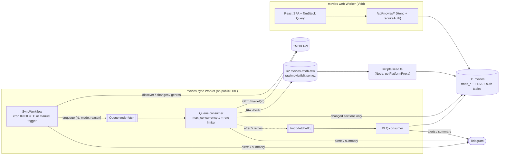

# Movies: a Horror & Thriller catalogue on Cloudflare

A non-commercial hobby project. It keeps a local, always-fresh copy of every **Horror and Thriller** movie on
[TMDB](https://www.themoviedb.org/) and serves it through a small bilingual (English / Russian) web app.
Everything runs on Cloudflare's developer platform and fits in the **$5/month Workers Paid** plan.

The project has two halves that share one database:

1. **The sync pipeline** (`workers/sync`, `packages/tmdb`). A scheduled Cloudflare Workflow finds every qualifying
   movie on TMDB, fetches each one through a self-rate-limited Queue consumer, archives the raw response in **R2**,
   and writes a normalized, search-indexed model into **D1**.
2. **The web app** (`apps/web`). A [Void](https://void.cloud) app (React SPA + Hono API routes + Better Auth) that
   reads the same D1. It has title search in English and Russian, a "most popular" grid and a movie page.

> **Design source of truth:** [`docs/SPEC.md`](docs/SPEC.md). Operations: [`docs/RUNBOOK.md`](docs/RUNBOOK.md).
> Measured facts and platform limits: [`docs/knowledge/`](docs/knowledge/). This README is an overview. When it
> disagrees with the spec, the spec wins.

---

## Contents

- [What it does](#what-it-does)
- [Tech stack](#tech-stack)
- [Repository layout](#repository-layout)
- [Architecture](#architecture)
  - [The big picture](#the-big-picture)
  - [Sync pipeline](#sync-pipeline)
  - [Storage model](#storage-model)
  - [Web app](#web-app)
  - [One database, two owners](#one-database-two-owners)
- [Cost guard and safety](#cost-guard-and-safety)
- [Getting started (local)](#getting-started-local)
- [Testing](#testing)
- [Deploying](#deploying)
- [TMDB terms and attribution](#tmdb-terms-and-attribution)

---

## What it does

**Which movies are included.** A movie *enters* the catalogue when it has the Horror (27) **or** Thriller (53)
genre, isn't `adult` or `video`, and has `vote_count ≥ 5`. That was about 40k movies in November 2026. The vote
threshold applies only at entry: an included movie leaves only when it loses both genres or is deleted on TMDB.
Rows in `tmdb_pinned_movies` stay synced even when they no longer qualify.

**What is stored.** The pipeline fetches wide and stores narrow. Each movie costs one TMDB request
(`/movie/{id}?append_to_response=credits,translations,release_dates,keywords,external_ids,videos,images,…`). The
full response is archived gzipped in R2. Only what the app needs goes into D1:

- core fields
- English and Russian translations
- genres (English and Russian names)
- keywords, companies, countries and collection
- US and RU release dates and certifications
- YouTube trailers and teasers
- the top 15 cast plus Director, Writer and Screenplay credits

Adding a column later means re-running the seed from R2, with no TMDB calls. Images are never copied; they're
served from `image.tmdb.org`.

**How fresh it is.** A daily run picks up new, gone and changed movies, plus a rolling *sweep* that guarantees
every stored movie is refetched at least every 90 days. TMDB's terms forbid caching for more than 6 months.

**What the app offers.** It's for signed-in users only (email + password):

- A centred search box with debounced, prefix-matching full-text search over the original, English and Russian
  titles (`ё` is folded to `е`).
- The 4 most-voted movies on the home page.
- A movie page with poster, titles, year, US certification, runtime, rating, genres, tagline, overview (Russian
  overview collapsible), director and writers, top-15 cast and an embedded YouTube trailer.

---

## Tech stack

| Layer | Technology | Used for |
|---|---|---|
| Language | **TypeScript 7** (strict, `noUncheckedIndexedAccess`) | everything |
| Monorepo | **pnpm workspaces**, Node 24 (`devEngines`) | `apps/*`, `packages/*`, `workers/*`, `scripts` |
| Compute | **Cloudflare Workers** | sync Worker (`movies-sync`), app Worker (`movies-web`) |
| Orchestration | **Cloudflare Workflows** (`WorkflowEntrypoint`, `step.do` / `step.sleep`, cron `schedules`) | the daily / bootstrap / replay run |
| Work queue | **Cloudflare Queues** + dead-letter queue | per-movie fetch jobs; the consumer is the global rate limiter |
| Raw archive | **Cloudflare R2** | `raw/movie/{id}.json.gz`, the full TMDB response |
| Database | **Cloudflare D1** (SQLite) with **FTS5** | normalized movie model, search index, sync bookkeeping, auth tables |
| Schema / migrations | **Drizzle ORM** + `drizzle-kit` (TMDB tables), Void-managed Drizzle (auth tables) | two separate migration histories in one database |
| Tooling | **Wrangler 4** (`wrangler dev`, `getPlatformProxy`, `workflows trigger --local`) | local dev, seeding, deploys |
| App framework | **Void 1.7** (Vite-based full-stack framework for Workers) | file-based API routes, typed `fetch`, Better Auth, D1 bindings, deploys |
| API | **Hono** handlers via Void's `defineHandler`, **Zod 4** validation | `/api/movies/*` |
| Auth | **Better Auth** (Void-managed, email provider) | sign-up / sign-in / sessions |
| UI | **React 19**, **Vite 8**, `@vitejs/plugin-react` | SPA |
| Client data | **TanStack Query 5** on Void's typed `fetch` | caching, debounced search, placeholder data |
| Tests | **Vitest 5**; `node:sqlite` for SQL; `@cloudflare/vitest-plugin` (workerd) for the Worker | unit + integration |
| Alerts | **Telegram Bot API** | circuit-breaker trips, auth errors, DLQ, daily summary |
| Observability | Workers Logs (structured JSON), 5% trace sampling | |

---

## Repository layout

```
/
├─ packages/tmdb/            Shared domain library, no Cloudflare runtime dependencies
│  ├─ src/config.ts          genre IDs, vote threshold, discover limits, languages
│  ├─ src/client.ts          TmdbClient: typed TMDB calls, v3 key / v4 token auto-detect, error classification
│  ├─ src/membership.ts      discover vote-count slicing, daily plan (gone > new > changed), sweep sizing
│  ├─ src/qualify.ts         decideState(): active / excluded rules (entry-only vote threshold, pinning)
│  ├─ src/normalize.ts       TMDB response → NormalizedMovie (the one shared normalizer)
│  ├─ src/hash.ts            per-section hashes (cyrb53 over stable JSON) for change detection
│  ├─ src/writes.ts          idempotent SQL builders: rewrite only changed sections, ≤ 100 params per stmt
│  ├─ src/queries.ts         read SQL for the app: popular, FTS search, movie detail (5-stmt batch)
│  ├─ src/schema.ts          Drizzle definitions of every tmdb_* table
│  ├─ migrations/            0000_init, 0001_movie_search (FTS5 + triggers), 0002_movie_votes_index
│  └─ test/                  Vitest under Node; SQL runs against the real migrations via node:sqlite
│
├─ workers/sync/             The pipeline Worker (own wrangler.jsonc, deliberately NOT at the repo root)
│  ├─ src/index.ts           queue() entrypoint (fetch queue + DLQ); exports SyncWorkflow; no fetch handler
│  ├─ src/workflow.ts        SyncWorkflow: bootstrap / daily / replay runs
│  ├─ src/consumer.ts        handleFetchBatch: guard → paced fetch → R2 → D1 batch → ack / retry / park
│  ├─ src/dlq.ts             dead letters → tmdb_sync_failures + Telegram
│  ├─ src/guard.ts           daily spending circuit breaker
│  ├─ src/pacer.ts           Pacer (≤ N req/s) and mapLimit (≤ 6 in flight)
│  ├─ src/store.ts           R2 gzip archive, D1 helpers, run counters, sync state, genre refresh
│  ├─ src/telegram.ts        notify() (falls back to console without secrets)
│  └─ test/                  Vitest in workerd with real local D1 / R2 and an injected fake fetch
│
├─ apps/web/                 Void app (SPA + API)
│  ├─ routes/api/movies/     popular.ts, search.ts, [id].ts (all behind requireAuth)
│  ├─ server/tmdb.ts         runs @movies/tmdb's SQL over the shared D1 binding
│  ├─ src/                   React: App (auth gate), ~40-line history router, pages, TanStack Query hooks
│  ├─ db/                    Void-owned schema + migrations (Better Auth tables only)
│  ├─ void.config.ts         D1 binding to the shared `movies` database, email auth
│  └─ vite.config.ts         voidPlugin({ persistTo }) shares local state with workers/sync
│
├─ scripts/
│  ├─ seed.ts                R2 → D1 rebuild using the SAME normalizer/writer (local, --remote, --remote-db)
│  └─ fixtures-refresh.ts    downloads real TMDB samples into gitignored fixtures/real/
│
└─ docs/                     SPEC.md (design), RUNBOOK.md (operations), knowledge/ (measured facts)
```

Dependency direction: `apps/web` → `packages/tmdb`; `workers/sync` → `packages/tmdb`; `scripts` →
`workers/sync` (store helpers) + `packages/tmdb`. `packages/tmdb` depends on nothing in the repo, so the domain
logic is testable under plain Node.

---

## Architecture

### The big picture



### Sync pipeline

The pipeline Worker exposes **no HTTP surface at all**: `workers_dev: false`, `preview_urls: false`, no routes and
no `fetch` handler. It has a `queue()` handler and a Workflow class. A run is started by the Workflow's cron
schedule or by `wrangler workflows trigger tmdb-sync '<json>' [--local]`.

#### 1. The Workflow (`workers/sync/src/workflow.ts`)

`SyncWorkflow` extends `WorkflowEntrypoint`. Each phase is a durable `step.do`: its return value is persisted, so a
retried or resumed instance skips completed work. Waiting uses `step.sleep`. A run takes `{ mode, limit?,
resetGuard?, drainIntervalSeconds? }`:

| Mode | What it enqueues | Consumer behaviour |
|---|---|---|
| `bootstrap` | every member (or the top-`limit` by votes) | `crawl`: write **R2 only**; skip objects fetched < 24 h ago, so a crawl can be resumed |
| `daily` (cron default) | new ∪ gone ∪ changed ∪ sweep (one reason per movie) | `sync`: R2 + D1 |
| `replay` | everything in `tmdb_parked` plus unresolved `tmdb_sync_failures` | `sync` |

A daily run goes through these steps:

1. **Start / guard check.** Record the run in `tmdb_sync_runs`. If the circuit breaker is tripped, alert and stop.
2. **Refresh genre names** in English and Russian (2 requests).
3. **Membership** from `/discover/movie?with_genres=27|53`. Discover returns at most 500 pages × 20 results, and
   `total_results` is capped at 20,001. So `planVoteSlices()` binary-splits the `vote_count` range at the geometric
   mean until every slice has ≤ 10,000 results. Each slice is then its own step. Discover calls are paced
   separately at `DISCOVER_RPS` (10/s). Membership doesn't come from TMDB's daily export files because those don't
   carry genres.
4. **Plan** (`planDaily`, priority *gone > new > changed*):
   - `new`: in membership, not in D1.
   - `gone`: active in D1, not in membership, not pinned.
   - `changed`: `/movie/changes` IDs since the last success (−1 day, clamped to 14 days) that are known to D1.
   - `sweep`: the oldest `last_synced_at` rows, `ceil(active / 80)` per day, which gives a ≤ 90-day refresh cycle.
     If the run is more than 13 days behind, a catch-up sweep adds every movie older than the changes window.
5. **Enqueue** `{ id, mode, reason, runId }` messages in batches of 100.
6. **Purge** rows that have been `excluded`/`deleted` for more than 90 days, their R2 objects, and orphaned people.
7. **Drain.** Poll per-run counters (`processed + dead ≥ enqueued`) with `step.sleep`, then record
   `last_success_date` and send the Telegram summary.

#### 2. The queue consumer (`workers/sync/src/consumer.ts`)

The consumer runs with `max_concurrency: 1` and `max_batch_size: 50`. Because only one invocation runs at a time,
it is the **global TMDB rate limiter**, and no Durable Object token bucket is needed. For each batch it:

1. **Guard pre-check.** If the breaker is tripped, or this batch would cross a daily cap, it parks every message in
   `tmdb_parked`, acks them and alerts once.
2. **Fetches** with a `Pacer` (≤ `TMDB_RPS` = 20 req/s) and `mapLimit(…, 6)`, which respects Workers' limit of
   6 simultaneous outgoing connections. Together with discover's 10/s that's about 30/s, against TMDB's roughly
   40/s.
3. **Classifies** each response with `TmdbClient`:

   | Result | Action |
   |---|---|
   | 200 | normalize → `decideState()` → archive gzipped JSON to R2 → (sync mode) build section writes |
   | 404 | deletion flow: look the movie up with `/find` by stored IMDb, then Wikidata ID. Exactly one match → `tmdb_movie_redirects` + enqueue the new ID. Otherwise `state=deleted` + a failure row for manual review. |
   | 429 / 5xx / timeout | stop fetching, retry the rest with exponential backoff + jitter (30–60 s × 2ⁿ, ≤ 30 min). TMDB sends no `Retry-After`. |
   | 401 | fatal: park the rest, trip the breaker, alert |
   | 400 | ack and record a `bad_request` failure |

4. **Writes** all D1 statements for the batch in grouped `db.batch()` calls. It then updates run counters and the
   guard counters, which use real `meta.rows_written`, and runs a guard post-check.

A movie that doesn't qualify and isn't already stored is never written anywhere. That keeps the 90-day rule simple.

Messages that exhaust `max_retries: 5` go to **`tmdb-fetch-dlq`**. Its consumer (`dlq.ts`) records them in
`tmdb_sync_failures`, bumps the run's `dead` counter so the drain still completes, and alerts.

#### 3. Change detection and idempotent writes (`packages/tmdb/src/hash.ts`, `writes.ts`)

Every normalized movie is split into ten **sections**: core, translations, genres, keywords, companies, countries,
collection, release_dates, videos and credits. Each section is hashed (cyrb53 over key-sorted JSON), and the hashes
are stored in `tmdb_movies.section_hashes`. `buildMovieWrite()` emits SQL only for sections whose hash changed:

- **Child tables** are rewritten by deleting the movie's rows and inserting the new set.
- **Upserts** are `INSERT … ON CONFLICT DO UPDATE … WHERE (cols) IS NOT (excluded.cols)`. A no-op update costs no
  D1 row writes.
- **Insert size:** multi-row `INSERT`s are chunked to respect D1's 100-bound-parameter limit.
- **Statement order:** the `tmdb_movies` row, which carries the hashes, is always the **last** statement for a
  movie. If a batch is only partly applied, the stored hashes never claim a section was written when it wasn't.

The result is that a refetch of an unchanged movie writes almost nothing. A vote-count change rewrites one row.

#### 4. Two-stage bootstrap: crawl to R2, then seed D1

The first load is split in two. A `bootstrap` run crawls into **R2 only**. Then `scripts/seed.ts`, a Node script
using Wrangler's `getPlatformProxy()`, reads the archive and runs **the same `normalizeMovie` + `buildMovieWrite`**
as the consumer. It can target:

- local R2 → local D1 (default)
- cloud R2 → cloud D1 (`--remote`; a dry run unless `--yes`)
- local R2 → cloud D1 (`--remote-db --yes`)

This makes rebuilding D1 from R2 a routine, TMDB-free operation. Use it for schema changes, backfills and disaster
recovery.

### Storage model

**R2** (`movies-tmdb-raw`) stores the full `/movie/{id}` response at `raw/movie/{id}.json.gz`, with `fetched_at`
in custom metadata. It's the source of truth for rebuilding D1.

**D1** (`movies`, location hint `weur`) holds every TMDB table, all prefixed `tmdb_`:

| Group | Tables |
|---|---|
| Catalogue | `tmdb_movies` (with `state` = active / excluded / deleted, `last_synced_at`, `section_hashes`), `tmdb_movie_translations` (en, ru), `tmdb_genres`, `tmdb_movie_genres`, `tmdb_keywords`, `tmdb_movie_keywords`, `tmdb_companies`, `tmdb_movie_companies`, `tmdb_movie_countries`, `tmdb_collections`, `tmdb_release_dates` (US, RU), `tmdb_videos` (YouTube trailers/teasers) |
| People | `tmdb_people` (built only from credits, no person-detail fetches), `tmdb_movie_credits` |
| Search | `tmdb_movie_search`: an **FTS5** table (`unicode61 remove_diacritics 2`) over original/en/ru titles, kept in sync by six triggers on `tmdb_movies` and `tmdb_movie_translations` |
| Identity | `tmdb_movie_redirects` (old → new ID after a TMDB merge), `tmdb_pinned_movies` |
| Bookkeeping | `tmdb_sync_state`, `tmdb_sync_runs`, `tmdb_run_counters`, `tmdb_guard_counters`, `tmdb_parked`, `tmdb_sync_failures` |

The Drizzle schema lives in `packages/tmdb/src/schema.ts`. Migrations are generated with `drizzle-kit` and applied
with `wrangler d1 migrations apply`, using their own history table `tmdb_migrations`.

### Web app

```
Browser (React SPA)                         movies-web Worker (Void)                 D1
───────────────────                         ────────────────────────                 ──
App ── auth.useSession() ──► Better Auth ─────────────────────────────────────────►  user/session/…
 │     signed out → /signin?next=…  (next must be a same-app path)
 ├─ HomePage ─ useMovieSearch(q) ─► GET /api/movies/search?q=  ─► requireAuth ─► searchMoviesStmt (FTS5 MATCH)
 │           └ usePopularMovies() ─► GET /api/movies/popular   ─► requireAuth ─► popularMoviesStmt (vote_count desc)
 └─ MoviePage ─ useMovie(id) ──────► GET /api/movies/:id       ─► requireAuth ─► movieDetailStmts → one db.batch
```

- **Routing.** About 40 lines of `history` + `useSyncExternalStore` (`src/router.tsx`). Four screens don't justify
  a router dependency.
- **Data.** TanStack Query hooks (`src/api.ts`) call Void's **typed `fetch`** from `void/client/react`, so route
  paths, params and response types come straight from the handlers. Search is debounced (250 ms), needs at least
  2 characters, is mirrored in `/?q=`, and keeps the previous list while typing (`keepPreviousData`). Enter opens
  the first result.
- **API.** `routes/api/movies/*` are Void `defineHandler`s (Hono), with Zod validation on search. Every handler
  calls `requireAuth`.
- **SQL.** The read SQL lives in `@movies/tmdb` (`queries.ts`) and is executed by `server/tmdb.ts` over the raw D1
  binding. That keeps the TMDB schema out of Void's ORM.
- **Search queries.** `toFtsQuery()` turns user input into quoted prefix terms that must all match. Quoting makes
  arbitrary input safe. `ё` is folded to `е` both in the trigger SQL and on the query side.
- **"Not found".** In Void's SPA mode, any API 404 falls through to `index.html` with status 200. So a missing
  movie is returned as data (`{ movie: null }`), and invalid IDs get a 400.
- **Images and attribution.** Images are hotlinked from `image.tmdb.org`. The footer carries the TMDB logo and the
  required notice.

### One database, two owners

The sync Worker and the app bind the **same D1 database** under the name `DB`. Ownership is split cleanly:

| Owner | Tables | Schema | Migration history |
|---|---|---|---|
| `packages/tmdb` (applied by Wrangler) | `tmdb_*` | `packages/tmdb/src/schema.ts` | `tmdb_migrations` |
| Void (`apps/web`) | `user`, `session`, `account`, `verification` | `apps/web/db/schema.ts` | `_void_migrations` |

The TMDB tables must never appear in Void's `db/schema.ts`: Void's drift check and `void db generate` would try to
manage them. User tables don't declare foreign keys into `tmdb_*`; ID remapping after TMDB merges happens in code.

**Locally**, both tools open the *same SQLite file*. They use the same persist directory
(`wrangler dev --persist-to .wrangler/state` and `voidPlugin({ persistTo: "../../workers/sync/.wrangler/state" })`)
and the same `database_id`. Don't add a `preview_database_id`: the Void CLI honours it, but Void's Vite dev server
ignores it, so the two would open different files.

---

## Cost guard and safety

Cloudflare has **no hard spending cap**, and budget alerts arrive by email a day late. So the pipeline protects
itself:

- **Circuit breaker** (`guard.ts`). It keeps per-UTC-day counters of real TMDB requests, R2 writes and D1
  `rows_written`, with caps of 50k, 50k and 1M (`GUARD_MAX_*` vars). Hitting a cap, or a TMDB 401, trips the
  breaker: remaining work is parked, a single Telegram alert goes out, and nothing runs until a manual
  `{"mode":"replay","resetGuard":true}`.
- **Fuses:**
  - Queues: `max_concurrency: 1`, `max_retries: 5`, a dead-letter queue, 4-day message retention.
  - Workflow: `limits.steps: 2000`.
  - Worker: `limits.cpu_ms: 60000`, `limits.subrequests: 20000`.
- **No public surface** on the sync Worker.
- **Kill switch:** `wrangler queues pause-delivery tmdb-fetch`, terminate the Workflow instance, and if needed purge
  the queue. See the [runbook](docs/RUNBOOK.md#kill-switch-stop-everything-now).
- **Budget alerts** at $1, $5 and $10.

---

## Getting started (local)

Everything runs locally against local D1, R2, Queues and Workflows (no cloud cost). The local Worker calls the
**real TMDB API**, and sends real Telegram messages if those secrets are set.

**Prerequisites**

- pnpm 12 (the exact version is pinned in `packageManager`).
- Node ≥ 24.22, which Void requires. `devEngines.runtime` in the root `package.json` makes pnpm download a matching
  Node and use it for `pnpm <script>` and `pnpm exec`, so an older system Node is fine as long as you run tools
  through pnpm (`pnpm exec void …`, not `npx void …`).
- A TMDB v4 Read Access Token.

**Configuration.** Put a `.dev.vars` at the repo root (gitignored) and symlink it into `workers/sync/.dev.vars`:

```ini
TMDB_READ_ACCESS_TOKEN=<v4 token>      # or TMDB_TOKEN=<v3 key or v4 token>
TELEGRAM_BOT_TOKEN=<optional>
TELEGRAM_CHAT_ID=<optional, numeric>
```

**1. Install and prepare a fresh database.** Run Void's migrations before the TMDB ones; see
[RUNBOOK § 1a](docs/RUNBOOK.md#1a-local-test-app-appsweb) for why:

```sh
pnpm install
pnpm web                                       # start once so Void records persistTo, then Ctrl-C
pnpm --filter @movies/web db:migrate:local     # auth tables
pnpm --filter @movies/sync db:migrate:local    # tmdb_* tables + FTS5
```

**2. Crawl a subset and seed D1:**

```sh
pnpm dev                                       # wrangler dev for the sync Worker (keep running)

# in another terminal, inside workers/sync:
npx wrangler workflows trigger tmdb-sync '{"mode":"bootstrap","limit":300,"drainIntervalSeconds":10}' --local
npx wrangler workflows instances describe tmdb-sync latest --local

# back at the repo root:
pnpm seed                                      # local R2 → local D1

# optional: a daily run over the same subset (use the SAME limit)
npx wrangler workflows trigger tmdb-sync '{"mode":"daily","limit":300,"drainIntervalSeconds":10}' --local
```

**3. Run the app:**

```sh
pnpm web                                       # http://localhost:5173. Sign up, then search.
```

Useful extras:

- Press `e` in `wrangler dev` to open the Local Explorer.
- `pnpm fixtures:refresh` downloads real TMDB samples into `fixtures/real/` (gitignored).
- To reset everything: `rm -rf workers/sync/.wrangler/state`, then repeat step 1.

### Root scripts

| Script | Does |
|---|---|
| `pnpm dev` | `wrangler dev` for the sync Worker, persisting to `workers/sync/.wrangler/state` |
| `pnpm web` | Void + Vite dev server for `apps/web` |
| `pnpm seed` | rebuild D1 from R2 (`-- --limit N`, `-- --ids 1,2`, `-- --remote [--yes]`, `-- --remote-db --yes`) |
| `pnpm test` | all Vitest suites |
| `pnpm typecheck` | `tsc` in every package |
| `pnpm fixtures:refresh` | download real TMDB samples (gitignored) |

---

## Testing

```sh
pnpm test
pnpm typecheck
```

- **`packages/tmdb`** runs under Node. It tests the client, normalizer, hashing, membership planning, SQL writers
  and read queries. The generated SQL is executed against the **real migrations** using Node's built-in
  `node:sqlite`, so FTS5 triggers and upserts are exercised for real. Inputs are synthetic, TMDB-shaped fixtures.
- **`workers/sync`** runs inside **workerd** through `@cloudflare/vitest-plugin`, with real local D1 and R2. TMDB is
  faked by injecting a `fetch` function into the consumer (`ConsumerDeps`), so no network mocking library is
  needed. The test config overrides the TMDB and Telegram secrets, so tests never call real services.

---

## Deploying

Both Workers deploy into one Cloudflare account. Deploys are manual for now, and there's a single production
environment.

- **App:** `cd apps/web && pnpm exec void deploy --platform cloudflare`. This builds, saves a D1 restore point,
  applies pending Void migrations and publishes `movies-web`.
- **Pipeline:** create the R2 bucket and both queues, set the secrets with `wrangler secret put`, apply
  `db:migrate:remote`, then `wrangler deploy` in `workers/sync`.

On a fresh database the order matters: Void migrations first, then TMDB migrations. Bootstrap a limited subset
before letting the unlimited 09:00 UTC schedule run. The full checklist, operations, guard resume, DLQ handling and
the purge-everything procedure are in [`docs/RUNBOOK.md`](docs/RUNBOOK.md).

> The sync Worker's `wrangler.jsonc` lives in `workers/sync/` on purpose. If `void deploy` finds a `wrangler.jsonc`
> at the repo root, it offers to adopt that Worker into the Void project.

---

## TMDB terms and attribution

This product uses TMDB and the TMDB APIs but is not endorsed, certified, or otherwise approved by TMDB.

The project follows TMDB's API terms:

- **Non-commercial only.** Any AI experiments over TMDB data stay private.
- **No data older than 90 days**, well inside the 6-month caching limit.
- **No images copied.**
- **Attribution.** The app shows the TMDB logo and the notice above.
- **Purge on termination.** [RUNBOOK § 6](docs/RUNBOOK.md#6-purge-all-tmdb-content-license-termination) describes
  how to delete all TMDB content if the licence ends.
